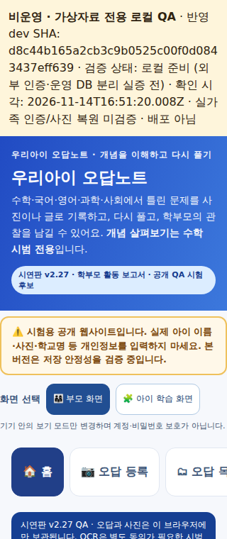
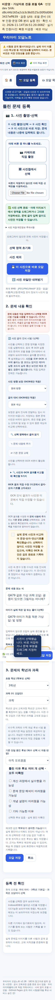
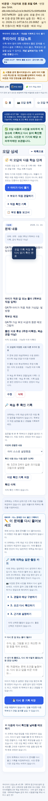
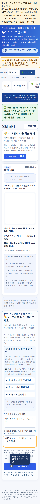
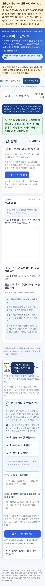
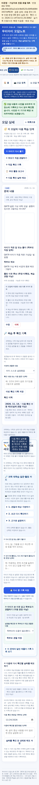
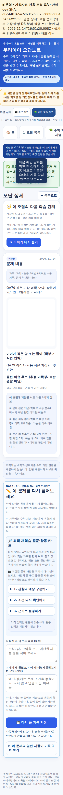
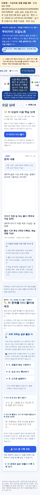
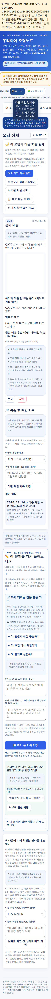

# 우리아이 오답노트 — 수정 후 가상 화면 10장 (비배포)

> 합성 가상자료만 사용한 **로컬 Chromium 320px 시연 캡처**입니다. 실제 인증·배포/실폰/실OCR 검증이 아니며, `safeToRestore:false`입니다. 보기 모드 전환은 가족 인증을 대신하지 않습니다.

**열람:** 이미지 제목을 누르면 GitHub에서 해당 원본 PNG를 개별로 엽니다. 아래 그림도 클릭하면 커집니다.

**수정 전 결함 화면(`baseline/`)은 이 폴더로 복사하지 않았습니다.**

## 단계별 화면 (같은 가상 오답 ID 1건)

### 01 부모가 시작 화면을 확인

[원본 PNG 열기](./01-parent-entry.png)

### 02 같은 가상 오답과 1픽셀 합성 사진 등록

[원본 PNG 열기](./02-parent-registration.png)

### 03 오답 ID·원본 사진 저장 후 상세 확인

[원본 PNG 열기](./03-parent-record-saved.png)

### 04 아이가 답과 자기 설명 직접 작성

[원본 PNG 열기](./04-child-explains.png)

### 05 같은 오답에 아이 재풀이 이력 저장

[원본 PNG 열기](./05-child-retry-saved.png)

### 06 부모가 아이 설명을 듣고 관찰 기록

[원본 PNG 열기](./06-parent-observation.png)

### 07 다음 확인 희망일·질문을 수동 기록

[원본 PNG 열기](./07-parent-followup-history.png)

### 08 아이 모드 복귀·부모 전용 DOM 차단

[원본 PNG 열기](./08-child-after-parent.png)

### 09 아이가 같은 문제 다시 열어보기

[원본 PNG 열기](./09-child-reentry.png)

### 10 부모 복귀 후 메모·관찰·이력 유지

[원본 PNG 열기](./10-parent-returns.png)

## 출처와 검증 범위

- [학부모 단계별 설명 v1](../wrong-qa79-parent-photo-guide-v1.md)
- [기존 QA79 Actions](https://github.com/jinbh99-arch/uri-wrong-answer-qa/actions/runs/43617826347) — 수정 전·후 각 11/11 가상 Chromium PASS 기록
- [기존 Artifact 14121874656](https://github.com/jinbh99-arch/uri-wrong-answer-qa/actions/runs/43617826347/artifacts/14121874656) — 이곳에서 **fixed 10장만** 무수정 복사
- [기존 개인정보 국소 수정 PR #67](https://github.com/jinbh99-arch/uri-wrong-answer-qa/pull/67)
- 시작점·캡처에 표시된 SHA: `d8c44b165a2cb3c9b0525c00f0d0843437eff639` (수정 전 기준). 이 이미지 자체는 **dev 최종 SHA의 외부 배포 증거가 아닙니다**.
- 실제 가족 인증·권한/저장소 분리·실폰·실OCR·Netlify 호스팅·06 독립 동적 시험은 **미검증**. 이 화면은 비배포 문서 자료입니다.